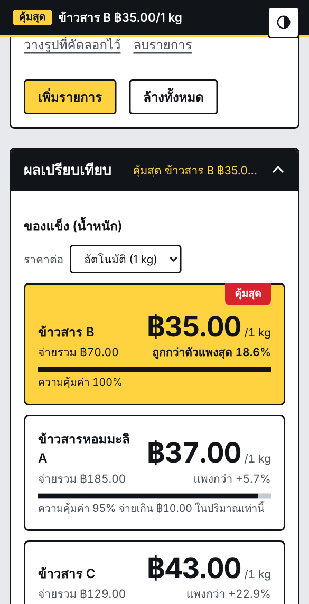
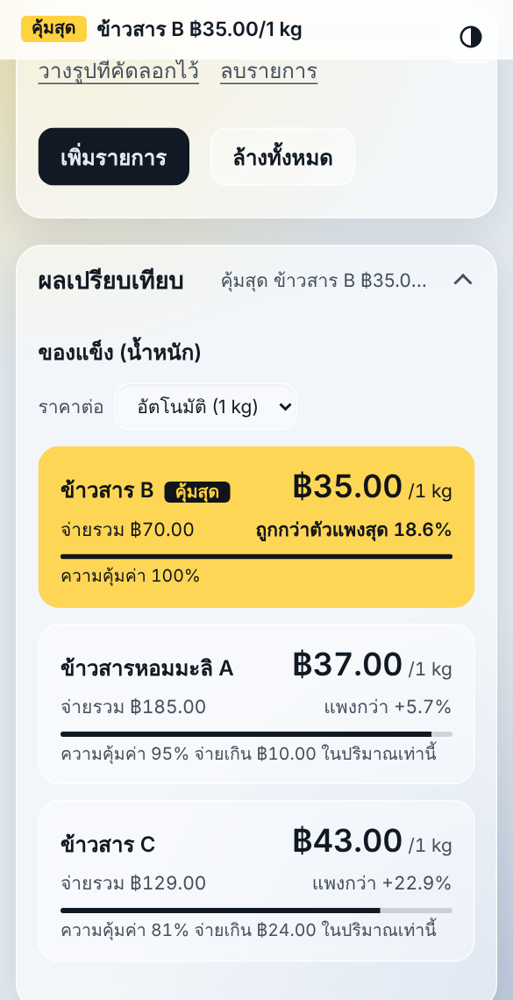
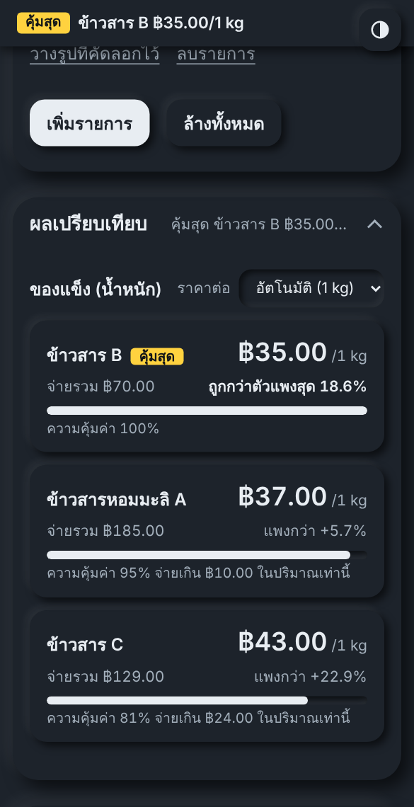
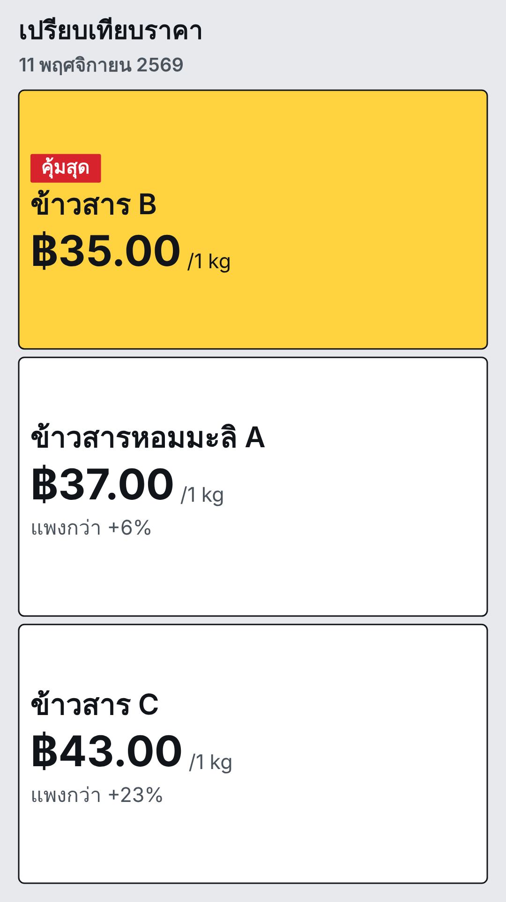

# เปรียบเทียบราคา (Price Compare PWA)

เว็บแอปเปรียบเทียบราคาต่อหน่วยของสินค้าหลายรายการ บอกทันทีว่าตัวไหนคุ้มสุด แล้วสร้างรูปสรุปไปแชร์ได้เลย
ทำงานในเบราว์เซอร์ล้วนๆ ไม่มีเซิร์ฟเวอร์ ไม่ต้องสมัครสมาชิก ติดตั้งลงหน้าจอโฮมและใช้งานออฟไลน์ได้

ตัวอย่างหน้าตา (รูปแบบ ป้ายราคา, กระจก, นูน) และรูปสรุปที่สร้างได้:

<p>
  
  
  
  
</p>

## ฟีเจอร์

**เปรียบเทียบราคา**
- ใส่ได้ไม่จำกัดรายการ: ชื่อ ราคา ปริมาณที่ได้ และหน่วย
- หน่วยแบ่งเป็น 3 หมวด ได้แก่ ของแข็ง (mg, g, kg), ของเหลว (ml, L) และอื่นๆ (ชิ้น, โหล, แพ็ค)
- เลือกหน่วยที่รายการแรก รายการอื่นจะแสดงเฉพาะหน่วยในหมวดเดียวกัน
- ถ้าหน่วยไม่เท่ากัน ระบบแปลงเป็นหน่วยย่อยสุดให้เอง (เช่น kg กับ g แสดงเป็นต่อ 1 g) ถ้าเหมือนกันหมดจะแสดงตามหน่วยนั้น และเปลี่ยนหน่วยแสดงผลได้เอง
- เลือกหน่วย "แพ็ค" จะมีช่องกรอก "จำนวนชิ้นในแพ็ค" เพื่อเทียบเป็นราคาต่อชิ้น
- แสดงราคาต่อหน่วย ตัวที่คุ้มสุด % ที่แพงกว่า % ที่ถูกกว่าตัวแพงสุด ความคุ้มค่า และเงินที่จ่ายเกินในปริมาณเท่ากัน
- แถบสรุป "คุ้มสุด" ติดบนสุดของหน้าตลอดเวลาที่กรอก

**รูปสำหรับแชร์**
- แทรกรูปให้แต่ละรายการได้ (เลือกไฟล์ วางจากคลิปบอร์ด หรือลากมาวาง)
- สร้างรูปรวมทุกรายการ เลือกขนาด 1:1, 4:3, 3:2, 16:9, 3:4, 2:3, 4:5, 9:16 หรืออัตโนมัติ (ค่าเริ่มต้น 9:16)
- ตำแหน่งข้อความในการ์ด: ในรูป (ค่าเริ่มต้น) ซ้าย ขวา บน หรือล่างของรูป และเลือกให้รูปเต็มกรอบหรือเห็นทั้งรูป
- หัวเรื่อง วันที่ และข้อความท้ายรูป เปิดปิดได้ ปรับขนาด จัดแนว และเลือกตำแหน่งบน/ล่างได้
- ธีมของรูป: ป้ายราคา, กระจก, น้ำเงิน, สว่าง, มืด
- บันทึกเป็น PNG หรือแชร์ผ่านระบบของเครื่อง

**ธีมและสี** (ปุ่มวงกลมครึ่งดำที่มุมขวาบน)
- รูปแบบหน้าเว็บ 4 แบบ: แบน, นูน (Neumorphism), ป้ายราคา, กระจก (Glassmorphism)
- โหมดอัตโนมัติ สว่าง หรือมืด
- ปรับสีเน้นและสีริบบิน "คุ้มสุด" ได้ (เลือกจากชุดสีหรือเลือกสีเอง)

**PWA**
- ติดตั้งลงหน้าจอโฮมได้ (Android/Chrome มีปุ่ม "ติดตั้งแอป", iPhone ให้ใช้ แชร์ แล้วเพิ่มไปยังหน้าจอโฮม)
- ใช้งานออฟไลน์ได้หลังเปิดครั้งแรก

## วิธีใช้งานแบบเร็ว

1. กรอกรายการแรก: ชื่อ ราคา ปริมาณ แล้วเลือกหน่วย
2. กรอกรายการที่สอง (กด "เพิ่มรายการ" ถ้าต้องการมากกว่านี้) ดูผลที่แถบบนสุดหรือในส่วน "ผลเปรียบเทียบ"
3. ใส่รูปแต่ละรายการ (ถ้าต้องการ) แล้วไปที่ "รูปสำหรับแชร์" ปรับรูปแบบตามชอบ
4. กด "บันทึกรูป PNG" หรือ "แชร์"

## ขึ้นออนไลน์ด้วย GitHub Pages

1. อัปโหลดไฟล์ทั้งหมดในโฟลเดอร์นี้ไปที่รากของ repo (Add file แล้วเลือก Upload files)
2. ไปที่ Settings แล้วเลือก Pages ตั้ง Source เป็น Deploy from a branch เลือก branch `main` และโฟลเดอร์ `/ (root)` แล้วบันทึก
3. รอสักครู่ เว็บจะอยู่ที่ `https://<ชื่อผู้ใช้>.github.io/<ชื่อ repo>/` ซึ่งเป็น https จึงติดตั้งเป็นแอปได้

ทุกลิงก์ในโค้ดเป็นแบบ relative จึงใช้ได้ทั้งใต้ชื่อ repo และโดเมนของตัวเอง

## ทดลองในเครื่อง

service worker ทำงานเฉพาะบน https หรือ localhost จึงควรเปิดผ่านเซิร์ฟเวอร์ในเครื่อง ไม่ใช่เปิดไฟล์ตรงๆ

```bash
python3 -m http.server 8080
# เปิด http://localhost:8080
```

## โครงสร้างไฟล์

| ไฟล์ | หน้าที่ |
| --- | --- |
| `index.html` | แอปทั้งหมด (HTML, CSS, JavaScript ในไฟล์เดียว) |
| `manifest.webmanifest` | ข้อมูลแอปสำหรับติดตั้ง (ชื่อ ไอคอน สี) |
| `sw.js` | service worker เก็บไฟล์ไว้ใช้ออฟไลน์ |
| `icons/` | ไอคอนแอป (192, 512, maskable), ไอคอน iPhone, favicon (svg, png, ico) |
| `docs/` | รูปตัวอย่างที่ใช้ใน README |
| `.nojekyll` | บอก GitHub Pages ไม่ต้องประมวลผลด้วย Jekyll |

## ข้อมูลและความเป็นส่วนตัว

ทุกอย่างอยู่ในเบราว์เซอร์ของเครื่องที่ใช้ (localStorage) ไม่มีการส่งรูปหรือข้อมูลไปที่ไหน

| คีย์ | เก็บอะไร |
| --- | --- |
| `pc_items_v2` | รายการสินค้า รูปที่ย่อแล้ว หน่วยแสดงผลที่เลือก |
| `pc_theme2` | รูปแบบ โหมด สีเน้น สีริบบิน |
| `pc_ui` | ตั้งค่าส่วนสร้างรูป (ขนาด ตำแหน่งข้อความ ธีมรูป หัวเรื่อง ฯลฯ) |
| `pc_ioshint` | จำว่าปิดคำแนะนำติดตั้งบน iPhone แล้ว |

ข้อควรรู้: ข้อมูลไม่ซิงก์ข้ามเครื่องหรือข้ามเบราว์เซอร์ และจะหายถ้าล้างข้อมูลเว็บ ปุ่ม "คืนค่าเริ่มต้นของรูป" และ "คืนค่าธีมเริ่มต้น" ใช้ล้างเฉพาะส่วนที่เกี่ยวข้อง

## วิธีคำนวณ

- ราคาต่อหน่วย = ราคา ÷ (ปริมาณ × ตัวคูณหน่วย) × หน่วยที่แสดง โดยตัวคูณแปลงทุกหน่วยในหมวดเดียวกันเป็นหน่วยฐาน (g, ml, ชิ้น)
- หน่วยที่แสดงแบบอัตโนมัติ คือหน่วยเล็กสุดที่ใช้อยู่ในหมวดนั้น
- ความคุ้มค่า = ราคาต่อหน่วยของตัวที่ถูกสุด ÷ ราคาต่อหน่วยของรายการนั้น (ตัวที่ถูกสุดเท่ากับ 100%)
- รายการแพ็ค: ปริมาณที่ได้ × จำนวนชิ้นในแพ็ค = จำนวนชิ้นทั้งหมด

## อัปเดตเวอร์ชัน

เมื่อแก้ไฟล์แล้วอยากให้เครื่องที่ติดตั้งไว้รับของใหม่ ให้เปลี่ยนค่า `V` ใน `sw.js` (เช่น `pc-v5` เป็น `pc-v6`) หน้าเว็บหลักพยายามโหลดจากอินเทอร์เน็ตก่อนอยู่แล้ว ใช้ของที่เก็บไว้เมื่อออฟไลน์เท่านั้น

## ข้อจำกัดที่ควรรู้

- ฟอนต์ IBM Plex Sans Thai โหลดจาก Google Fonts ต้องออนไลน์ครั้งแรกเพื่อให้ฟอนต์ถูกเก็บไว้ ถ้ายังไม่เคยโหลดจะใช้ฟอนต์ระบบแทน
- เบราว์เซอร์ในแอปบางตัว (เช่นหน้าเว็บที่เปิดในแอปแชท) อาจไม่เปิดตัวเลือกไฟล์ ให้ใช้วิธีวางรูปจากคลิปบอร์ด หรือเปิดลิงก์ใน Chrome หรือ Safari
- ธีมกระจกใช้ `backdrop-filter` ถ้าเบราว์เซอร์ไม่รองรับจะเปลี่ยนเป็นพื้นทึบกว่าเดิม

## เครดิต

- แนวคิดเริ่มต้นจากโปรเจกต์ [harshitha-vadla0108/Price-Comparison-Project](https://github.com/harshitha-vadla0108/Price-Comparison-Project)
- ฟอนต์ [IBM Plex Sans Thai](https://fonts.google.com/specimen/IBM+Plex+Sans+Thai) (SIL Open Font License)
- แนวทางตรวจและออกแบบหน้าตาอ้างอิงแนวคิดจาก [heydamir/unslop](https://github.com/heydamir/unslop)

## ไลเซนส์

ยังไม่ได้ระบุ หากต้องการเปิดให้ผู้อื่นนำไปใช้ต่อ ให้เพิ่มไฟล์ `LICENSE` ที่ราก repo (เลือกแม่แบบได้ที่ Add file แล้วเลือก Create new file ตั้งชื่อ `LICENSE`)
